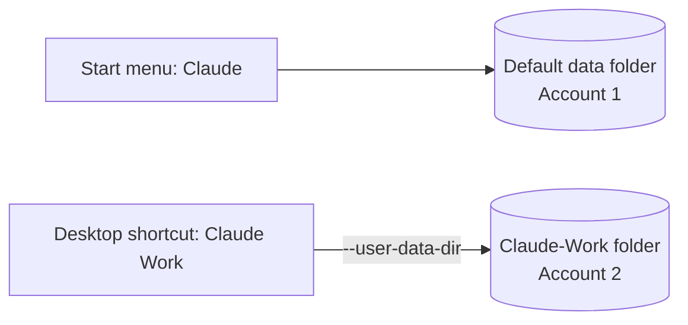

<div align="center">

# 👥 Claude Desktop Multi-Account for Windows

**Run two Claude accounts side by side on the Windows desktop app. No logging out, no switching back and forth.**


**English** · [Português (Brasil)](README.pt-BR.md)

</div>

> [!WARNING]
> This is a **community workaround**, not an official feature, and it is **not affiliated with Anthropic**. An app update may require adjustments. "Claude" is a trademark of Anthropic and is used here only to describe which app this works with.

## ⚡ Quick start

1. Find where `claude.exe` lives (Task Manager → *Open file location*).
2. Quit Claude completely, then test the command below in PowerShell and log in with your **second** account.
3. Save the command as a `.bat` file and make a desktop shortcut called **Claude Work**.
4. Use the normal Claude for account 1 and **Claude Work** for account 2. Both can stay open together.

Full walkthrough in the **Step by step** section below.

## 🧠 How it works

The Claude desktop app is built on Electron, which accepts a `--user-data-dir` option. That option sets the folder where the app keeps its login, session and settings. Launch the app pointing at a different folder and it behaves like a separate installation, so **each folder holds one account**.



| Account | How to open it | Where the data lives |
| --- | --- | --- |
| Account 1 | Regular Claude from the Start menu | The app's default folder |
| Account 2 | The **Claude Work** shortcut | `Claude-Work`, inside your user folder |

## 🙏 Credits

The original idea (tested on a Mac) was shared by [igorkas in a Reddit discussion](https://www.reddit.com/r/ClaudeAI/comments/1rkdigx/comment/oe0kazz/). This repository adapts the method to Windows with the MSIX version of the app.

## ✅ Requirements

- Windows with the Claude desktop app already installed and working with account 1.
- The sign-in details for account 2.
- Permission to create files on your Desktop and in Documents.

This guide covers the Windows app installed as an **MSIX package**, which is what you get from the official download at claude.com/download and, as far as we know, from the Microsoft Store as well. To check whether it applies to you, follow step 1: if the path starts with `C:\Program Files\WindowsApps\`, this guide is for you.

## 🛠️ Step by step

### Step 1: Find where the app is installed

1. With Claude open, launch Task Manager (`Ctrl + Shift + Esc`).
2. Expand the **Claude** group and right-click one of the processes **inside** it, not the group itself. If **Open file location** is still greyed out, use the **Details** tab, find `claude.exe`, and right-click that.
3. In the window that opens, click the address bar and copy the full path. It looks like this:

```text
C:\Program Files\WindowsApps\Claude_<version>_x64__<code>\app
```

The version number and the code differ between machines and change with every update. Always use the path you see on your own computer.

### Step 2: Quit Claude completely

After copying the path, right-click the Claude icon in the system tray (near the clock) and choose **Quit/Exit**. Then check Task Manager to make sure no "Claude" process is left.

### Step 3: Test it in PowerShell

Open PowerShell and paste the command below. Replace the quoted part with the path from step 1, ending in `\claude.exe`:

```powershell
& "C:\Program Files\WindowsApps\Claude_<version>_x64__<code>\app\claude.exe" --user-data-dir="$env:USERPROFILE\Claude-Work"
```

If a Claude window opens asking you to sign in, it worked. The `Claude-Work` folder is created automatically inside your user folder.

### Step 4: Sign in with the second account

In the window that opened, sign in with account 2, then close the window. From now on that folder holds account 2, and you won't need to sign in again.

### Step 5: Create the `.bat` file

1. Copy [`scripts/claude-work.bat`](scripts/claude-work.bat) from this repository (or create one in Notepad with the same content) and fix the program path.
2. If you create it in Notepad, use **File → Save as**, set the type to **All files**, and name it `Claude Work.bat`.
3. Keep the file in a folder other than the Desktop, for example `Documents\Shortcuts`.
4. Double-click it to test. Claude should open already signed in to account 2.

### Step 6: Create the Desktop shortcut

1. Right-click the `.bat` file and choose **Create shortcut**.
2. Drag the shortcut to the Desktop and rename it **Claude Work** (`F2`), dropping the ".bat".
3. Optional: in the shortcut's **Properties**, set **Run** to **Minimized** so the black console window doesn't flash. Use **Change Icon** to pick a different icon and tell the two accounts apart.
4. Optional: **Pin to taskbar**.

The `.bat` has to stay where it is, because the shortcut depends on it.

## 🧪 Experimental: auto-detect script

The biggest weakness of this method is that the version number is part of the path, so it changes whenever the app updates. [`scripts/launch-claude-work.ps1`](scripts/launch-claude-work.ps1) tries to find the install location automatically.

> [!NOTE]
> This script has **not been tested on every setup**. Try it before relying on it. If it doesn't work on your machine, use the regular `.bat`.

To use it, open PowerShell in the script's folder and run:

```powershell
powershell -NoProfile -ExecutionPolicy Bypass -File .\launch-claude-work.ps1
```

## 📅 Daily use

- **Account 1:** open Claude from the Start menu as usual.
- **Account 2:** open the **Claude Work** shortcut.
- Both can stay open at the same time. The windows share the same icon, so check which account is which before typing anything sensitive.
- History and settings are kept separate for each account.

## 🍎 macOS

The principle is the same. With Claude closed, run this in Terminal:

```bash
open -n -a "Claude" --args --user-data-dir="$HOME/Library/Application Support/Claude-Work"
```

Sign in with the second account, then close it. To avoid Terminal every time, you can wrap the command in an app made with Script Editor, as described in the [original discussion](https://www.reddit.com/r/ClaudeAI/comments/1rkdigx/comment/oe0kazz/). This part comes from the original idea and was not tested by this repository's author.

## 🔀 Other alternatives

| Option | Where it works | Upside | Watch out for |
| --- | --- | --- | --- |
| Browser profiles (Chrome, Edge, Brave) | claude.ai in the browser | Built into the browser, accounts open at the same time | Switching profiles is manual |
| Account-switcher extensions | Chromium-based browsers | One-click switching | Third-party, and they handle login cookies: read the permissions and prefer open source |
| App for one account, phone browser for the other | iOS and Android | Needs nothing extra | The phone app doesn't switch between different emails |

Survey done in October 2026 via web search. The third-party tools were not tested here.

## ⚠️ Limitations and cautions

> [!IMPORTANT]
> Each account keeps its own plan and limits. Check the usage rules for each plan before using this method at work.

- **Not official.** It relies on an internal Electron option and may change with updates.
- **Desktop app only.** Browser and phone need the alternatives above.
- **Link-based sign-in.** For sign-ins that hand control back to the app through a browser link (such as the email link), the return may land on the wrong instance. If that happens, close the other Claude window before signing in. This was not tested.
- **Account 2's session sits in an ordinary folder.** Anyone with access to your Windows user can reach that account. Use a screen lock and don't share the computer.

## 🩺 Troubleshooting

| Symptom | Likely cause | What to do |
| --- | --- | --- |
| The shortcut stopped working after an update | The path changed to a new version | Repeat step 1 and edit the `.bat`, swapping the version part. Your login stays saved |
| "Open file location" is greyed out | You clicked the "Claude" group | Expand the group and click a process inside it, or use the Details tab |
| Nothing happens, or "Access denied", in step 3 | Wrong path, or protected folder | Check the path you copied in step 1 and that it ends in `\claude.exe` |
| **Claude Work** opens already on account 1 | The main instance was still running, or the option was ignored | Close every Claude window (tray and Task Manager) and open it again |
| It asks you to sign in every time | The `Claude-Work` folder moved or was deleted | Make sure the `.bat` always uses the same `--user-data-dir` path |
| A black window flashes on launch | Normal behavior of a `.bat` file | In the shortcut's Properties, set Run to Minimized |

## 🧹 Uninstall

Delete the **Claude Work** shortcut, the `Claude Work.bat` file and the `Claude-Work` folder. Account 1 is not affected.

## 🤝 Contributing

Tested on another Windows version, on an ARM64 machine, or on an older standalone install? Found a fix? Open an issue or a pull request.

## 📄 License

[MIT](LICENSE)
