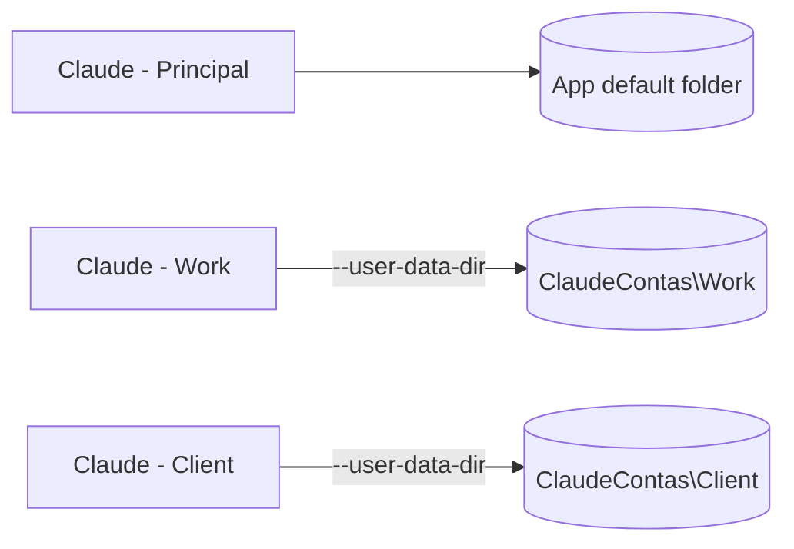

<div align="center">

# 👥 Claude Contas: several Claude Desktop accounts on Windows

**One "Claude app" per account, each with its own Desktop shortcut and icon, all open at the same time. No logging out, no switching, and no breakage when Claude updates.**


**English** · [Português (Brasil)](README.pt-BR.md)

</div>

> [!WARNING]
> This is a **community workaround**, not an official feature, and it is **not affiliated with Anthropic**. "Claude" is a trademark of Anthropic and is mentioned only to say which app this works with.

## 📌 What Claude Contas is

The Claude desktop app keeps one account signed in at a time. **Claude Contas** is a small tool (a PowerShell script, no programs to install) that makes Windows treat each account as a separate app:

```text
Desktop
 ├─ Claude - Principal   → your usual account
 ├─ Claude - Work        → another account, another window
 └─ Claude - Client X    → one more, and so on
```

Each shortcut opens Claude with its own folder, which holds that account's sign-in, local chats and settings. All windows can stay open side by side.

### What you can do

| Feature | How |
| --- | --- |
| **Create as many "Claude apps" as you want** (up to 9 accounts), each with a Desktop and Start menu shortcut | In the installer, or later from the menu → **N** |
| **A different icon per account**: Claude logo with a colored badge and initial, or colored numbered icons | Installer or menu → **I** |
| **Open them all at once**; clicking an account that is already open brings its window forward | Shortcuts |
| **Sign in to each account without mixing them up**, Google sign-in included | Menu → **E** |
| **Rename and remove accounts** without losing the sign-in | Menu → **M** / **R** |
| **Scheduled automatic update**: at startup and at the times you choose (e.g. lunch), silently | Installer or menu → **H** |
| **Self-test**: confirms in seconds that the method works on the installed Claude version | Menu → **T** |
| **Diagnostics**: version, shortcuts, scheduler, who is signed in, duplicate accounts | Menu → **D** |
| **Automatic repair** of deleted shortcuts | Menu → **C** (the scheduler does it too) |
| **Claude Code skill** that investigates and fixes things if Claude changes | Installer or menu → **K** |
| Portuguese and English | Follows Windows, or `-Idioma pt/en` |

## ⚡ Install

First: have Claude Desktop installed ([claude.com/download](https://claude.com/download)) and signed in to your main account. Pick **one** way.

### 1. On your own, with one command (1 minute)

Open **PowerShell** (Windows key, type `powershell`, Enter; no admin needed), paste and press Enter:

```powershell
irm https://raw.githubusercontent.com/VinguardCP/claude-desktop-multi-account-windows/main/install.ps1 | iex
```

The installer asks, in order:

1. Main account name.
2. How many extra accounts and their names.
3. Icon style.
4. Whether to schedule updates, and at which times.
5. Whether to install the Claude Code skill (only asked if you use Claude Code).
6. Whether to sign in to each account now.

### 2. Ask an AI that runs commands

Works with Claude Code, Codex, Cursor, Windsurf, Gemini CLI or Copilot in agent mode. Copy **Prompt A** from [PROMPT.md](PROMPT.md) and paste it into the AI. It:

1. Reads this repository and the script before running anything.
2. Asks the questions in the chat.
3. Installs and tests.
4. Walks you through each sign-in.

Short version, if you prefer:

```text
Install Claude Contas for me (https://github.com/VinguardCP/claude-desktop-multi-account-windows)
following "Prompt A" in that repository's PROMPT.md. Read the README and the script before running it and ask
me the account names, icon style, scheduler and skill before installing.
```

### 3. Ask a chat AI (ChatGPT, Gemini, Claude.ai)

Copy **Prompt B** from [PROMPT.md](PROMPT.md). The AI explains the tool, asks the questions and builds **one ready command** for you to paste into PowerShell.

### 4. Without downloading anything at install time

Download the repository (green **Code → Download ZIP** button) and extract it. Right-click `install.ps1` → **Run with PowerShell**. It uses the `claude-contas.ps1` in the same folder.

## 🔐 Signing in to the extra accounts

In the menu, press **E**. The helper:

1. Closes the Claude windows while you sign in.
2. Opens only the chosen account.
3. Hands it the sign-in link the browser sends back (with Google sign-in, Windows would send that link to the main account).
4. Waits 45 seconds for Claude to save the sign-in.
5. Reopens the main account.

> [!IMPORTANT]
> Claude writes the sign-in to disk about every 30 seconds. If you force-close it (Task Manager) right after signing in, the sign-in is lost and the account asks you to sign in again. To close an account, use the Claude icon near the clock → **Quit**.

## 🎨 Icons

- **logo** (default): the Claude logo installed on your computer, with a colored badge and the account initial. It is built on your machine from the app itself; this repository does not distribute the logo.
- **numerado** (numbered): the project's own icons, one number and color per account (1 = main). They live in [`icons/`](icons) and are built by [`tools/gerar-icones.ps1`](tools/gerar-icones.ps1).


## 🔄 When Claude updates

Nothing you need to do:

- **Shortcuts do not break.** They start Claude through an official app alias (`claude-desktop.exe`) that does not change between versions. Version 1 of this project used the app's folder path, which changes on every update.
- **The tool updates itself** when a fix is published here. It checks the file before swapping it in.
- **The scheduled update** (optional) runs hidden at startup and at the chosen times. It:
  - updates the tool;
  - rebuilds deleted shortcuts;
  - when Claude changes version, tests the accounts.

  If something breaks, you get a notification near the clock. If the computer was off at a scheduled time, it runs once the computer is back on.

## 🧰 Menu

Start menu → **Claude Contas → Claude Contas (menu)**:

```text
Claude Contas v2.2.0
  1. Principal  (main, open)
  2. Work       (signed in, open)

  [A] Open an account         [E] Sign in to an account
  [N] New account             [R] Remove account    [M] Rename
  [H] Scheduled update        [I] Icon style
  [D] Diagnostics             [T] Test that the method works
  [C] Fix shortcuts           [U] Update now        [K] Claude Code skill
```

<details>
<summary><b>Command line (for scripts and AIs)</b></summary>

All run as `powershell -NoProfile -ExecutionPolicy Bypass -File "%LOCALAPPDATA%\ClaudeContas\claude-contas.ps1" <options>`:

| Option | What it does |
| --- | --- |
| *(none)* | Opens the menu |
| `-Instalar` | Guided install, with questions |
| `-Instalar -Sim -NomePrincipal X -Contas "A,B" -Icones logo\|numerado -Agendar "12:00" -ComSkill -SemEntrar` | Install with no questions (`-SemAgendador`, `-SemSkill` turn those off) |
| `-Abrir <name>` | Opens an account (what the shortcuts do) |
| `-Entrar <name> [-Sim]` | Sign-in helper |
| `-Adicionar <name> [-Pasta <folder>]` | Adds an account (optionally in an existing folder) |
| `-Renomear <name> -Para <new>` | Renames, keeping the sign-in |
| `-Remover <name>` | Removes it from the menu and shortcuts (asks before deleting its folder) |
| `-Agendar "08:00,12:00"` / `-Desagendar` | Turns on/changes or turns off the scheduled update |
| `-Diagnostico` / `-Testar` / `-Reparar` / `-Atualizar` | Diagnostics, self-test, fix shortcuts, update |
| `-Idioma pt\|en` | Forces the language (also via the `CLAUDE_CONTAS_IDIOMA` variable) |

</details>

## 🧠 How it works inside

Claude Desktop is an Electron app. The `--user-data-dir` option sets the folder where it keeps sign-in, session and settings. The app treats each folder as a separate instance.



The code of Claude Desktop 6.28899.6 reads `--user-data-dir`, keeps the chosen folder (internal label `stay_chosen_folder`) and holds one instance per folder. The `CLAUDE_USER_DATA_DIR` variable is ignored by signed builds, so it is not used.

| What | Where |
| --- | --- |
| Tool, icons, config and log | `%LOCALAPPDATA%\ClaudeContas` |
| Sign-in and data of each extra account | `%USERPROFILE%\ClaudeContas\<name>` (the v1 `Claude-Work` folder is reused) |
| Scheduled task | Task Scheduler → `Claude Contas - Manutencao` |

## ✅ What was tested

On 2026-11-24, Windows 11, Claude Desktop 6.28899.6 (MSIX):

- **Accounts:** main + 3 extra accounts open at once from their shortcuts, each with its own folder and window.
- **Sign-in:**
  - it survives a forced close of Claude;
  - diagnostics confirm the extra account differs from the main one;
  - a Google sign-in link fired by Windows itself was caught and handed to the right account, not the main one.
- **Install:**
  - the one-line installer from start to finish, with its questions;
  - the no-questions install;
  - downloads from GitHub keep the accents intact.
- **Maintenance:**
  - automatic update from an old version to the new one;
  - the scheduled task running hidden (no admin);
  - the tray notification.
- **Menu and options:**
  - menu in Portuguese and English;
  - add, rename and remove accounts (accented names included);
  - both icon styles.
- **Claude Code:** the `/claude-contas` skill ran in a Claude Code session and updated, tested and diagnosed on its own.

Not tested: Windows 10, the legacy (non-MSIX) Claude install and corporate SSO sign-in.

## 🤖 Claude Code skill

In Claude Code, type `/claude-contas`. It:

1. Updates the tool.
2. Runs diagnostics and the self-test.
3. If Claude changed something, uses [`tools/investigar.ps1`](tools/investigar.ps1) to open the new version's code, find what changed and propose a fix.

## 🩺 Troubleshooting

| Symptom | What to do |
| --- | --- |
| I signed in, closed it, and it asked to sign in again | Claude was force-closed seconds after signing in. Sign in again from the menu → **E** and wait for the countdown; to close, use the icon near the clock → **Quit** |
| The extra account asks to sign in | Menu → **E**. Sessions expire from time to time |
| I signed in and landed in the main account | Use the menu → **E**, which hands the sign-in to the right account |
| Diagnostics says "SAME account" | Menu → **E** and sign in with the other email |
| The shortcut does nothing | Menu → **T**. If it fails, **U**. If it still fails, `/claude-contas` in Claude Code |
| A notification says the accounts stopped | Claude changed something. Run `/claude-contas` in Claude Code or open an issue |
| A shortcut is gone | Menu → **C** (the scheduler also brings it back) |
| "Running scripts is disabled on this system" | Use the install command exactly as above. It changes no Windows policy |

## ⚠️ Limitations

- **Unofficial.** It relies on an Electron option that Anthropic may change. The self-test and the scheduler tell you if it stops working.
- **Desktop app only.** In the browser, use Chrome/Edge profiles.
- **Taskbar:** open windows show the regular Claude icon. The colored badge is on the shortcuts.
- **Cowork, the Chrome extension and other features backed by Windows services or the browser** are shared by all instances and may clash between accounts (not tested in depth).
- **Each account has its own plan and limits.** Check your plan's terms before using this at work.
- **Security:** each account's sign-in lives in a folder of your Windows user. The auto-update only downloads from this repository. To turn it off, set `"autoAtualizar": false` in `%LOCALAPPDATA%\ClaudeContas\contas.json`.

## 🧹 Uninstall

1. Menu → **H** → turn off.
2. Menu → **R** for each account (choose whether to delete its folder).
3. Delete `%LOCALAPPDATA%\ClaudeContas`, the **Claude - Principal** shortcut and the **Claude Contas** Start menu folder.

The main account is not affected.

## 🙏 Credits

Original idea (on Mac) by [igorkas on Reddit](https://www.reddit.com/r/ClaudeAI/comments/1rkdigx/comment/oe0kazz/). On macOS: `open -n -a "Claude" --args --user-data-dir="$HOME/Library/Application Support/Claude-Work"` (not tested here).

## 📄 License

[MIT](LICENSE) · [Changelog](CHANGELOG.md) · [Install prompts](PROMPT.md)
