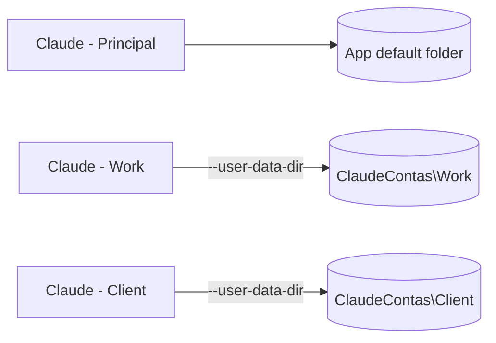

<div align="center">

# 👥 Claude Desktop Multi-Account for Windows

**Use several Claude accounts side by side in the Windows desktop app. No logging out, no switching, and no breakage when the app updates.**


**English** · [Português (Brasil)](README.pt-BR.md)

</div>

> [!WARNING]
> This is a **community workaround**, not an official feature, and it is **not affiliated with Anthropic**. "Claude" is a trademark of Anthropic and is mentioned only to say which app this works with.

## ⚡ Install

First: have Claude Desktop installed ([claude.com/download](https://claude.com/download)) and signed in to your main account.

### Option 1: one command (1 minute)

Open **PowerShell** (Windows key, type `powershell`, Enter; no admin needed), paste and press Enter:

```powershell
irm https://raw.githubusercontent.com/VinguardCP/claude-desktop-multi-account-windows/main/install.ps1 | iex
```

The installer asks:

1. A name for the main account (default: `Principal`).
2. How many extra accounts you want and the name of each.
3. The icon style.
4. Whether to schedule the automatic update, and at which times (e.g. lunch).
5. Whether to install the Claude Code skill (only asked if you use Claude Code).
6. Whether to sign in to each account now, with the sign-in helper.

### Option 2: let Claude Code do everything

Open [PROMPT.md](PROMPT.md), copy the prompt and paste it into Claude Code. It reads the script, asks the same questions in the chat, installs, tests and walks you through each sign-in.

### Result

The Desktop and Start menu get a shortcut for **each** account, the main one included:

| Shortcut | Opens |
| --- | --- |
| **Claude - Principal** | The account you already used |
| **Claude - Work**, **Claude - Client**... | Each extra account, in its own window |

All of them can stay open at once. Clicking the shortcut of an account that is already open brings its window to the front.

## 🎨 Icons

Two styles, switchable at any time (menu → **I**):

- **logo** (default): the Claude logo installed on your computer, with a colored badge and the account initial. The icon is built on your machine from the app itself; this repository does not distribute the logo.
- **numerado** (numbered): the project's own icons, one number and color per account. They live in [`icons/`](icons) and are built by [`tools/gerar-icones.ps1`](tools/gerar-icones.ps1).


## 🔄 What happens when Claude updates?

Nothing you need to do:

- **Shortcuts do not break.** They start Claude through an official app alias (`claude-desktop.exe`) that does not change between versions. Version 1 used the app's folder path, which changes on every update, and broke each time.
- **The tool updates itself** whenever a fix is published here.
- **The scheduled automatic update** (optional) runs hidden at sign-in and at the times you choose. It:
  - updates the tool;
  - rebuilds deleted shortcuts;
  - when Claude changes version, tests that the accounts still open.

  If something breaks, you get a notification near the clock. If the computer was off at a scheduled time, it runs as soon as it is back on.

Without the scheduler, the check happens once a day when you open a shortcut.

## 🧰 Management menu

Start menu → **Claude Contas → Claude Contas (menu)**. It follows the Windows language (Portuguese or English).

| Key | What it does |
| --- | --- |
| **A** | Open an account |
| **E** | Sign in to an account, with the helper |
| **N** | Add another account (up to 9 in total) |
| **R** | Remove an account (asks before deleting its sign-in) |
| **M** | Rename an account (the sign-in is kept) |
| **H** | Scheduled update: turn on, change times, turn off, run now |
| **I** | Icon style |
| **D** | Diagnostics: app version, shortcuts, scheduler, who is signed in, duplicate accounts |
| **T** | Test that the method works on the installed app version |
| **C** | Fix shortcuts and icons |
| **U** | Update the tool now |
| **K** | Install the Claude Code skill |

## 🔐 Why sign-in needs the helper

With Google, email-link or SSO sign-in, the browser hands the session back to the app through a `claude://` link. Windows always delivers that link to the **main** Claude. So:

- **Google**: the main Claude drops the code because it did not start that sign-in, and the new account never signs in.
- **Email link**: the main window may end up signed in to the new account.

The helper (**E** in the menu) does this:

1. Closes the main Claude while you sign in.
2. Catches the `claude://` link the browser sends back.
3. Hands the link to the right account's window.
4. Reopens the main Claude.

That is why "starting over" never fixed version 1.

## 🧠 How it works

Claude Desktop is an Electron app. The `--user-data-dir` option sets the folder where it keeps sign-in, session and settings. Each folder is one account, and the app treats each folder as a separate instance.



Tested in November 2026 with Claude Desktop **6.28899.6** (MSIX), on Windows 11, with **4 accounts open at once**. The current app code:

- reads `--user-data-dir`;
- keeps the chosen folder (internal label `stay_chosen_folder`);
- holds one single-instance lock per folder.

The `CLAUDE_USER_DATA_DIR` variable is ignored by signed builds, so it is not used here.

| What | Where |
| --- | --- |
| Tool, icons, config and log | `%LOCALAPPDATA%\ClaudeContas` |
| Sign-in and data of each extra account | `%USERPROFILE%\ClaudeContas\<name>` (the v1 `Claude-Work` folder is reused) |
| Scheduled task | Task Scheduler → `Claude Contas - Manutencao` |

## 🤖 Claude Code skill

The installer offers the skill; you can also install it later from the menu → **K**. In Claude Code, type `/claude-contas`. It:

1. Updates the tool.
2. Runs diagnostics and the self-test.
3. If the app changed, uses [`tools/investigar.ps1`](tools/investigar.ps1) to open the new version's code, find what changed and propose a fix.

## 🩺 Troubleshooting

| Symptom | What to do |
| --- | --- |
| I signed in, closed it, and it asked to sign in again | Claude was force-closed (Task Manager) seconds after signing in. It only writes the sign-in to disk about every 30 s. Sign in again and wait 1 minute; to close, use the Claude icon near the clock → **Quit**. The helper (**E**) already waits for this |
| The extra account asks to sign in | Menu → **E**. Sessions expire from time to time |
| I signed in and landed in the main account | Menu → **E**. The helper prevents this |
| Diagnostics says "SAME account" | Menu → **E** and sign in with the other email |
| The shortcut does nothing | Menu → **T** (Test). If it fails, **U** (Update). If it still fails, `/claude-contas` in Claude Code |
| A notification near the clock says the accounts stopped | Claude changed something. Run `/claude-contas` in Claude Code or open an issue |
| A shortcut is gone | Menu → **C** (Fix). The scheduler also brings it back |
| "Running scripts is disabled on this system" | Use the install command exactly as above. It changes no Windows policy |
| I still have `Claude Work.bat` from v1 | The installer offers to delete the old shortcut. The `Claude-Work` folder is reused |

## ⚠️ Limitations

- **Unofficial.** It relies on an Electron option that Anthropic may change. The self-test (**T**) and the scheduler tell you right away if it stops working.
- **Desktop app only.** In the browser, use Chrome/Edge profiles.
- **Taskbar:** open windows show the regular Claude icon. The colored badge is on the shortcuts. Check which account you are in before typing anything sensitive.
- **Cowork, the Chrome extension and other features backed by Windows services or the browser** are shared by all instances and may clash between accounts (not tested in depth).
- **Each account has its own plan and limits.** Check your plan's terms before using this at work.
- **Security:** each account's sign-in lives in a folder of your Windows user. Anyone using your Windows user can use the accounts. The auto-update only downloads from this repository and checks the file before swapping it in. To turn it off, set `"autoAtualizar": false` in `%LOCALAPPDATA%\ClaudeContas\contas.json`.

## 🧹 Uninstall

1. Menu → **H** → turn off the scheduler.
2. Menu → **R** for each account (choose whether to delete its folder).
3. Delete `%LOCALAPPDATA%\ClaudeContas`, the **Claude - Principal** shortcut and the **Claude Contas** Start menu folder.

The main account is not affected.

## 🙏 Credits

The original idea (on Mac) was shared by [igorkas on Reddit](https://www.reddit.com/r/ClaudeAI/comments/1rkdigx/comment/oe0kazz/). On macOS: `open -n -a "Claude" --args --user-data-dir="$HOME/Library/Application Support/Claude-Work"` (not tested here).

## 📄 License

[MIT](LICENSE) · [Changelog](CHANGELOG.md)
