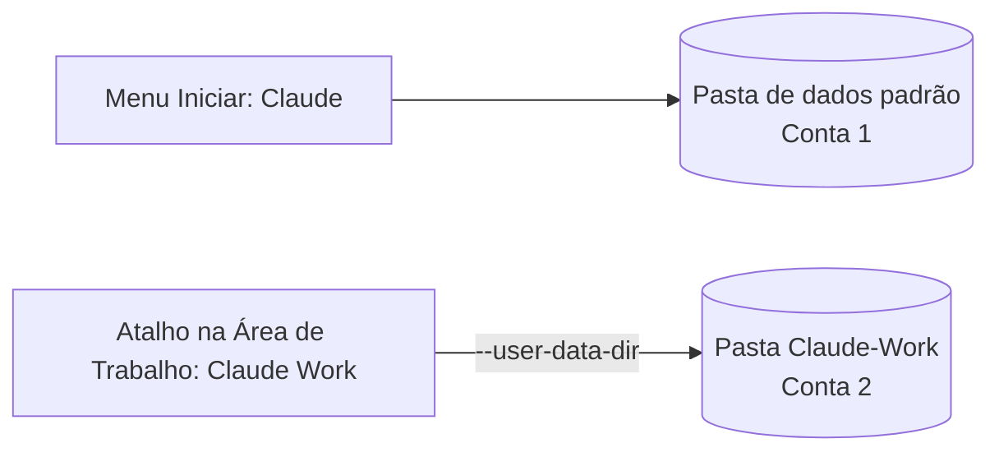

<div align="center">

# 👥 Claude Desktop Multi-Account para Windows

**Use duas contas do Claude lado a lado no app de desktop do Windows. Sem fazer logout, sem ficar trocando de conta.**


[English](README.md) · **Português (Brasil)**

</div>

> [!WARNING]
> Este é um **contorno técnico da comunidade**, não um recurso oficial, e **não tem vínculo com a Anthropic**. Uma atualização do app pode exigir ajustes. "Claude" é marca da Anthropic e é citada aqui apenas para dizer com qual app o método funciona.

## ⚡ Início rápido

1. Descubra onde está o `claude.exe` (Gerenciador de Tarefas → *Abrir local do arquivo*).
2. Feche o Claude por completo, teste o comando abaixo no PowerShell e entre com a **segunda** conta.
3. Salve o comando em um arquivo `.bat` e crie um atalho na Área de Trabalho chamado **Claude Work**.
4. Use o Claude normal para a conta 1 e o **Claude Work** para a conta 2. As duas podem ficar abertas juntas.

O passo a passo completo está na seção **Passo a passo**, logo abaixo.

## 🧠 Como funciona

O app de desktop do Claude é baseado em Electron, que aceita a opção `--user-data-dir`. Essa opção define a pasta onde o app guarda login, sessão e configurações. Ao abrir o app apontando para uma pasta diferente, ele se comporta como uma instalação separada, então **cada pasta guarda uma conta**.



| Conta | Como abrir | Onde ficam os dados |
| --- | --- | --- |
| Conta 1 | Claude normal, pelo menu Iniciar | Pasta padrão do app |
| Conta 2 | Atalho **Claude Work** | `Claude-Work`, dentro da sua pasta de usuário |

## 🙏 Créditos

A ideia original (testada em Mac) foi compartilhada por [igorkas em uma discussão no Reddit](https://www.reddit.com/r/ClaudeAI/comments/1rkdigx/comment/oe0kazz/). Este repositório adapta o método para o Windows com o app instalado como pacote MSIX.

## ✅ Requisitos

- Windows com o app Claude para desktop já instalado e funcionando com a conta 1.
- Os dados de acesso da conta 2.
- Permissão para criar arquivos na Área de Trabalho e em Documentos.

Este guia cobre o app do Windows instalado como **pacote MSIX**, que é o que você recebe pelo download oficial em claude.com/download e, até onde sabemos, também pela Microsoft Store. Para saber se vale para você, siga o passo 1: se o caminho começar com `C:\Program Files\WindowsApps\`, este guia é para você.

## 🛠️ Passo a passo

### Passo 1: descobrir onde o programa está

1. Com o Claude aberto, abra o Gerenciador de Tarefas (`Ctrl + Shift + Esc`).
2. Expanda o grupo **Claude** e clique com o botão direito em um dos processos **de dentro** dele, não no grupo. Se **Abrir local do arquivo** continuar desativado, use a aba **Detalhes**, procure `claude.exe` e repita o clique.
3. Na janela que abrir, clique na barra de endereço e copie o caminho completo. Ele tem este formato:

```text
C:\Program Files\WindowsApps\Claude_<versão>_x64__<código>\app
```

O número da versão e o código mudam de máquina para máquina e a cada atualização. Use sempre o caminho que aparecer no seu computador.

### Passo 2: fechar o Claude por completo

Depois de copiar o caminho, clique com o botão direito no ícone do Claude na bandeja do sistema (perto do relógio) e escolha **Sair**. Confira no Gerenciador de Tarefas se não restou nenhum processo "Claude".

### Passo 3: testar no PowerShell

Abra o PowerShell e cole o comando abaixo, trocando o trecho entre aspas pelo caminho do passo 1 e terminando em `\claude.exe`:

```powershell
& "C:\Program Files\WindowsApps\Claude_<versão>_x64__<código>\app\claude.exe" --user-data-dir="$env:USERPROFILE\Claude-Work"
```

Se abrir uma janela do Claude pedindo login, funcionou. A pasta `Claude-Work` é criada sozinha dentro da sua pasta de usuário.

### Passo 4: entrar com a segunda conta

Na janela que abriu, faça login com a conta 2 e depois feche a janela. A partir daí essa pasta guarda a conta 2 e você não precisa logar de novo.

### Passo 5: criar o arquivo `.bat`

1. Copie o arquivo [`scripts/claude-work.bat`](scripts/claude-work.bat) deste repositório (ou crie um no Bloco de Notas com o mesmo conteúdo) e ajuste o caminho do programa.
2. Se criar pelo Bloco de Notas, use **Arquivo → Salvar como**, tipo **Todos os arquivos**, nome `Claude Work.bat`.
3. Guarde o arquivo em uma pasta fora da Área de Trabalho, por exemplo `Documentos\Atalhos`.
4. Dê dois cliques para testar. O Claude deve abrir já logado na conta 2.

### Passo 6: criar o atalho na Área de Trabalho

1. Clique com o botão direito no `.bat` e escolha **Criar atalho**.
2. Arraste o atalho para a Área de Trabalho e renomeie para **Claude Work** (`F2`), sem o ".bat".
3. Opcional: nas **Propriedades** do atalho, em **Executar**, escolha **Minimizado** para a janela preta não piscar. Em **Alterar Ícone**, escolha outro ícone para distinguir as duas contas.
4. Opcional: **Fixar na barra de tarefas**.

O `.bat` precisa continuar na pasta onde está, porque o atalho depende dele.

## 🧪 Experimental: script que acha o caminho sozinho

O maior problema do método é que o número da versão faz parte do caminho e muda a cada atualização do app. O arquivo [`scripts/launch-claude-work.ps1`](scripts/launch-claude-work.ps1) tenta descobrir o local de instalação automaticamente.

> [!NOTE]
> Este script **não foi testado em todos os ambientes**. Teste antes de depender dele. Se não funcionar na sua máquina, use o `.bat` normal.

Para usar, abra o PowerShell na pasta do script e rode:

```powershell
powershell -NoProfile -ExecutionPolicy Bypass -File .\launch-claude-work.ps1
```

## 📅 Uso no dia a dia

- **Conta 1:** abra o Claude normal pelo menu Iniciar.
- **Conta 2:** abra o atalho **Claude Work**.
- As duas podem ficar abertas ao mesmo tempo. As janelas têm o mesmo ícone, então confira em qual conta cada uma está antes de escrever algo sensível.
- Histórico e configurações de cada conta ficam separados.

## 🍎 macOS

O princípio é o mesmo. Com o Claude fechado, rode no Terminal:

```bash
open -n -a "Claude" --args --user-data-dir="$HOME/Library/Application Support/Claude-Work"
```

Faça login com a segunda conta e feche. Para não usar o Terminal toda vez, dá para empacotar o comando em um app do Editor de Scripts, como descrito na [discussão original](https://www.reddit.com/r/ClaudeAI/comments/1rkdigx/comment/oe0kazz/). Esta parte vem da ideia original e não foi testada pelo autor deste repositório.

## 🔀 Outras alternativas

| Opção | Onde funciona | Vantagem | Cuidado |
| --- | --- | --- | --- |
| Perfis do navegador (Chrome, Edge, Brave) | claude.ai no navegador | Recurso do próprio navegador, contas simultâneas | Trocar de perfil é manual |
| Extensões de troca de conta | Navegadores baseados em Chromium | Troca com um clique | De terceiros e trabalham com cookies de login: leia as permissões e prefira código aberto |
| App em uma conta e navegador do celular na outra | iOS e Android | Não exige nada extra | O app do celular não alterna entre e-mails diferentes |

Levantamento feito em outubro de 2026 por pesquisa na web. As ferramentas de terceiros não foram testadas aqui.

## ⚠️ Limitações e cuidados

> [!IMPORTANT]
> Cada conta tem seu próprio plano e limites. Confira as regras de uso de cada plano antes de adotar o método no trabalho.

- **Não é oficial.** Depende de uma opção interna do Electron e pode mudar com atualizações.
- **Só vale para o app de desktop.** Navegador e celular precisam das alternativas acima.
- **Login por link.** Em logins que devolvem o acesso ao app por um link do navegador (como o link por e-mail), o retorno pode cair na instância errada. Se acontecer, feche a outra janela do Claude antes de entrar. Esse ponto não foi testado.
- **A sessão da conta 2 fica em uma pasta comum.** Quem acessar seu usuário do Windows acessa a conta. Use bloqueio de tela e não compartilhe o computador.

## 🩺 Solução de problemas

| Sintoma | Causa provável | O que fazer |
| --- | --- | --- |
| O atalho parou de abrir após uma atualização | O caminho mudou de versão | Repita o passo 1 e edite o `.bat` trocando o trecho da versão. O login continua guardado |
| "Abrir local do arquivo" está desativado | O clique foi no grupo "Claude" | Expanda o grupo e clique em um processo de dentro, ou use a aba Detalhes |
| Nada acontece ou aparece "Acesso negado" no passo 3 | Caminho errado ou pasta protegida | Confira o caminho copiado no passo 1 e que ele termina em `\claude.exe` |
| O **Claude Work** abre já na conta 1 | A instância principal ainda estava aberta, ou a opção foi ignorada | Feche todas as janelas do Claude (bandeja e Gerenciador de Tarefas) e abra de novo |
| Pede login toda vez | A pasta `Claude-Work` mudou ou foi apagada | Confira que o `.bat` usa sempre o mesmo caminho em `--user-data-dir` |
| Uma janela preta pisca ao abrir | Comportamento normal do `.bat` | Nas Propriedades do atalho, escolha Executar: Minimizado |

## 🧹 Desinstalar

Apague o atalho **Claude Work**, o arquivo `Claude Work.bat` e a pasta `Claude-Work`. A conta 1 não é afetada.

## 🤝 Contribuindo

Testou em outra versão do Windows, em uma máquina ARM64 ou em uma instalação antiga (standalone)? Encontrou um ajuste? Abra uma *issue* ou um *pull request*.

## 📄 Licença

[MIT](LICENSE)
