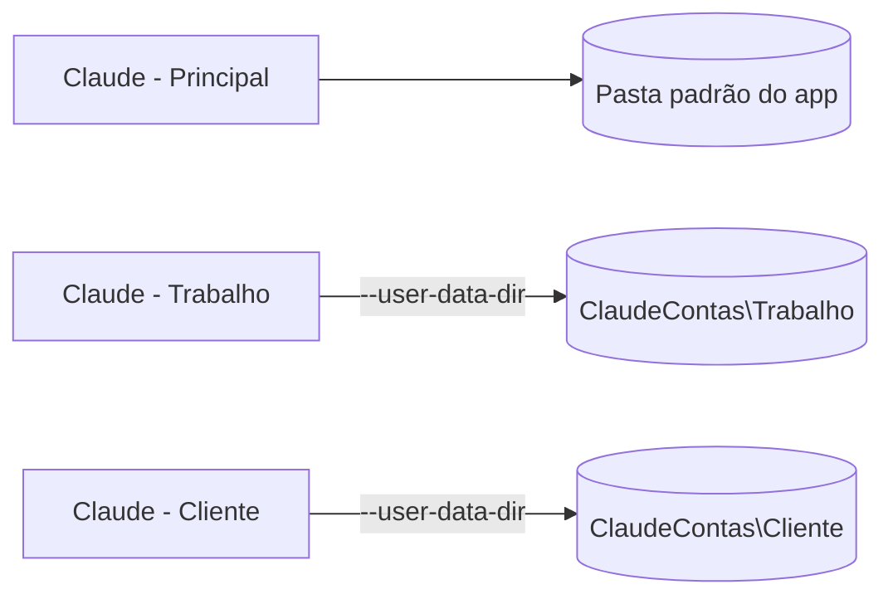

<div align="center">

# 👥 Claude Desktop Multi-Account para Windows

**Use várias contas do Claude lado a lado no app de desktop do Windows. Sem logout, sem trocar de conta, e sem quebrar quando o app atualiza.**


[English](README.md) · **Português (Brasil)**

</div>

> [!WARNING]
> Este é um **contorno técnico da comunidade**, não um recurso oficial, e **não tem vínculo com a Anthropic**. "Claude" é marca da Anthropic e é citada aqui só para dizer com qual app o método funciona.

## ⚡ Instalar

Antes: tenha o Claude Desktop instalado ([claude.com/download](https://claude.com/download)) e logado na sua conta principal.

### Opção 1: um comando (1 minuto)

Abra o **PowerShell** (tecla Windows, digite `powershell`, Enter; não precisa ser administrador), cole e aperte Enter:

```powershell
irm https://raw.githubusercontent.com/VinguardCP/claude-desktop-multi-account-windows/main/install.ps1 | iex
```

O instalador pergunta:

1. O nome da conta principal (padrão: `Principal`).
2. Quantas contas extras você quer e o nome de cada uma.
3. O estilo dos ícones.
4. Se quer a atualização automática agendada e em quais horários (ex.: no almoço).
5. Se quer a skill do Claude Code (só aparece se você usa o Claude Code).
6. Se quer entrar em cada conta agora, com o assistente de login.

### Opção 2: deixe o Claude Code fazer tudo

Abra o [PROMPT.md](PROMPT.md), copie o prompt e cole no Claude Code. Ele lê o script, faz as mesmas perguntas no chat, instala, testa e acompanha o login de cada conta.

### Resultado

Na Área de Trabalho e no menu Iniciar aparece um atalho para **cada** conta, inclusive a principal:

| Atalho | Abre |
| --- | --- |
| **Claude - Principal** | A conta que você já usava |
| **Claude - Trabalho**, **Claude - Cliente**... | Cada conta extra, numa janela separada |

Todas podem ficar abertas ao mesmo tempo. Clicar no atalho de uma conta já aberta só traz a janela dela para frente.

## 🎨 Ícones

Dois estilos, que dá para trocar a qualquer hora (menu → **I**):

- **logo** (padrão): o logo do Claude instalado no seu computador, com um selo colorido e a inicial da conta. O ícone é montado na sua máquina a partir do próprio app; este repositório não distribui o logo.
- **numerado**: ícones próprios do projeto, um número e uma cor por conta. Ficam em [`icons/`](icons) e são gerados por [`tools/gerar-icones.ps1`](tools/gerar-icones.ps1).


## 🔄 E quando o Claude atualizar?

Não precisa fazer nada:

- **Os atalhos não quebram.** Eles abrem o Claude por um apelido oficial do app (`claude-desktop.exe`) que não muda entre versões. A versão 1 usava o caminho da pasta do app, que muda a cada atualização, e por isso quebrava.
- **A ferramenta se atualiza sozinha** sempre que uma correção é publicada aqui.
- **A atualização automática agendada** (opcional) roda escondida ao ligar o computador e nos horários que você escolher. Ela:
  - atualiza a ferramenta;
  - refaz atalhos apagados;
  - quando o Claude muda de versão, testa se as contas continuam abrindo.

  Se algo quebrar, aparece um aviso perto do relógio. Se o computador estava desligado no horário marcado, ela roda assim que ele ligar.

Sem o agendador, a checagem acontece uma vez por dia, quando você abre um atalho.

## 🧰 Menu de gerenciamento

Menu Iniciar → **Claude Contas → Claude Contas (menu)**:

| Tecla | O que faz |
| --- | --- |
| **A** | Abrir uma conta |
| **E** | Entrar (fazer login) numa conta, com o assistente |
| **N** | Criar outra conta (até 9 no total) |
| **R** | Remover uma conta (pergunta antes de apagar o login) |
| **M** | Mudar o nome de uma conta (o login continua) |
| **H** | Atualização agendada: ligar, mudar horários, desligar, rodar agora |
| **I** | Estilo dos ícones |
| **D** | Diagnóstico: versão do app, atalhos, agendador, quem está logado, contas repetidas |
| **T** | Testar se o método funciona na versão atual do app |
| **C** | Consertar atalhos e ícones |
| **U** | Atualizar a ferramenta agora |
| **K** | Instalar a skill do Claude Code |

## 🔐 Por que o login precisa do assistente

No login pelo Google, pelo link do e-mail ou por SSO, o navegador devolve o acesso ao app por um link `claude://`. O Windows entrega esse link sempre ao Claude **principal**. Resultado:

- **Google**: o Claude principal descarta o código, porque não foi ele que começou o login. A conta nova fica sem entrar.
- **Link do e-mail**: a janela principal pode acabar entrando na conta nova.

O assistente (**E** no menu) faz assim:

1. Fecha o Claude principal enquanto você entra.
2. Pega o link `claude://` que o navegador devolve.
3. Entrega o link à janela da conta certa.
4. Reabre o Claude principal.

Era por isso que "refazer do zero" não resolvia na versão 1.

## 🧠 Como funciona

O Claude Desktop é um app Electron. A opção `--user-data-dir` define a pasta onde ele guarda login, sessão e configurações. Cada pasta é uma conta, e o app trata cada pasta como uma instância separada.



Testado em novembro de 2026 com o Claude Desktop **6.28899.6** (MSIX), no Windows 11, com **4 contas abertas ao mesmo tempo**. O código atual do app:

- lê `--user-data-dir`;
- mantém a pasta escolhida (rótulo interno `stay_chosen_folder`);
- trava uma instância por pasta.

A variável `CLAUDE_USER_DATA_DIR` é ignorada nas versões assinadas, por isso não é usada aqui.

| O quê | Onde |
| --- | --- |
| Ferramenta, ícones, configuração e log | `%LOCALAPPDATA%\ClaudeContas` |
| Login e dados de cada conta extra | `%USERPROFILE%\ClaudeContas\<nome>` (a pasta `Claude-Work` da versão 1 é reaproveitada) |
| Tarefa agendada | Agendador de Tarefas → `Claude Contas - Manutencao` |

## 🤖 Skill para o Claude Code

O instalador oferece a skill, e também dá para instalar depois pelo menu → **K**. No Claude Code, digite `/claude-contas`. Ele:

1. Atualiza a ferramenta.
2. Roda o diagnóstico e o autoteste.
3. Se o app tiver mudado, usa [`tools/investigar.ps1`](tools/investigar.ps1) para abrir o código da versão nova, achar o que mudou e propor a correção.

## 🩺 Solução de problemas

| Sintoma | O que fazer |
| --- | --- |
| A conta extra abre pedindo login | Menu → **E** (Entrar). A sessão expira de tempos em tempos |
| Fiz login e caiu na conta principal | Menu → **E**. O assistente evita isso |
| O diagnóstico diz "MESMA conta" | Menu → **E** e entre com o outro e-mail |
| O atalho não faz nada | Menu → **T** (Testar). Se falhar, **U** (Atualizar). Se continuar, `/claude-contas` no Claude Code |
| Apareceu um aviso perto do relógio dizendo que as contas pararam | O Claude mudou algo. Rode `/claude-contas` no Claude Code ou abra uma *issue* |
| Sumiu um atalho | Menu → **C** (Consertar). O agendador também refaz sozinho |
| "A execução de scripts foi desabilitada" | Use exatamente o comando de instalação acima. Ele não muda nenhuma política do Windows |
| Ainda tenho o `Claude Work.bat` da versão 1 | O instalador oferece apagar o atalho antigo. A pasta `Claude-Work` é reaproveitada |

## ⚠️ Limitações e cuidados

- **Não é oficial.** Depende de uma opção do Electron que a Anthropic pode mudar. O autoteste (**T**) e o agendador avisam na hora se parar de funcionar.
- **Só o app de desktop.** No navegador, use perfis do Chrome/Edge.
- **Barra de tarefas:** as janelas abertas usam o ícone normal do Claude. O selo colorido aparece nos atalhos. Confira em qual conta está antes de escrever algo sensível.
- **Cowork, extensão do Chrome e outros recursos ligados a serviços do Windows ou ao navegador** são compartilhados pelas instâncias e podem se confundir entre as contas (não testado a fundo).
- **Cada conta tem plano e limites próprios.** Confira as regras do seu plano antes de usar no trabalho.
- **Segurança:** o login de cada conta fica numa pasta do seu usuário do Windows. Quem usa o seu usuário acessa as contas. A atualização automática baixa só deste repositório e confere o arquivo antes de trocar. Para desligar, troque `"autoAtualizar": true` por `false` em `%LOCALAPPDATA%\ClaudeContas\contas.json`.

## 🧹 Desinstalar

1. Menu → **H** → desligar o agendador.
2. Menu → **R** para cada conta (escolha se quer apagar a pasta).
3. Apague `%LOCALAPPDATA%\ClaudeContas`, o atalho **Claude - Principal** e a pasta **Claude Contas** do menu Iniciar.

A conta principal não é afetada.

## 🙏 Créditos

A ideia original (em Mac) foi compartilhada por [igorkas no Reddit](https://www.reddit.com/r/ClaudeAI/comments/1rkdigx/comment/oe0kazz/). No macOS: `open -n -a "Claude" --args --user-data-dir="$HOME/Library/Application Support/Claude-Work"` (não testado aqui).

## 📄 Licença

[MIT](LICENSE) · [Histórico de versões](CHANGELOG.md)
