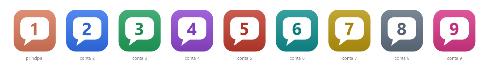
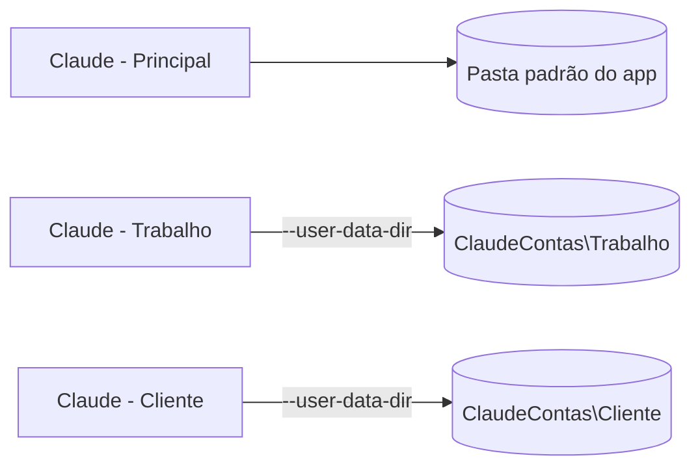

<div align="center">

# 👥 Claude Contas: várias contas do Claude Desktop no Windows

**Um "aplicativo Claude" para cada conta, com atalho e ícone próprios na Área de Trabalho, todos abertos ao mesmo tempo. Sem logout, sem trocar de conta, e sem quebrar quando o Claude atualiza.**


[English](README.md) · **Português (Brasil)**

</div>

> [!WARNING]
> Este é um **contorno técnico da comunidade**, não um recurso oficial, e **não tem vínculo com a Anthropic**. "Claude" é marca da Anthropic e é citada aqui só para dizer com qual app o método funciona.

## 📌 O que é o Claude Contas

O app de desktop do Claude só deixa uma conta logada por vez. O **Claude Contas** é uma ferramenta pequena (um script do PowerShell, sem instalar programas) que faz o Windows tratar cada conta como um aplicativo separado:

```text
Área de Trabalho
 ├─ Claude - Principal   → sua conta de sempre
 ├─ Claude - Trabalho    → outra conta, outra janela
 └─ Claude - Cliente X   → mais uma, e assim por diante
```

Cada atalho abre o Claude com uma pasta própria, onde ficam o login, as conversas locais e as configurações daquela conta. Todas as janelas podem ficar abertas lado a lado.

### O que dá para fazer

| Recurso | Como |
| --- | --- |
| **Criar quantos "aplicativos Claude" quiser** (até 9 contas), cada um com atalho na Área de Trabalho e no menu Iniciar | No instalador, ou depois no menu → **N** |
| **Ícone diferente para cada conta**: logo do Claude com selo colorido e inicial, ou ícones numerados coloridos | Instalador ou menu → **I** |
| **Abrir todas ao mesmo tempo**; clicar numa conta já aberta traz a janela dela para frente | Atalhos |
| **Fazer login em cada conta sem bagunçar as outras**, inclusive pelo Google | Menu → **E** |
| **Renomear e remover contas** sem perder o login | Menu → **M** / **R** |
| **Atualização automática agendada**: ao ligar o computador e nos horários que você escolher (ex.: almoço), em silêncio | Instalador ou menu → **H** |
| **Autoteste**: confirma em segundos se o método funciona na versão atual do Claude | Menu → **T** |
| **Diagnóstico**: versão, atalhos, agendador, quem está logado, contas repetidas | Menu → **D** |
| **Conserto automático** de atalhos apagados | Menu → **C** (o agendador também faz) |
| **Skill para o Claude Code** que investiga e corrige se o Claude mudar algo | Instalador ou menu → **K** |
| Português e inglês | Segue o Windows, ou `-Idioma pt/en` |

## ⚡ Instalar

Antes: tenha o Claude Desktop instalado ([claude.com/download](https://claude.com/download)) e logado na sua conta principal. Escolha **uma** das formas.

### 1. Sozinho, com um comando (1 minuto)

Abra o **PowerShell** (tecla Windows, digite `powershell`, Enter; não precisa ser administrador), cole e aperte Enter:

```powershell
irm https://raw.githubusercontent.com/VinguardCP/claude-desktop-multi-account-windows/main/install.ps1 | iex
```

O instalador pergunta, em ordem:

1. Nome da conta principal.
2. Quantas contas extras e o nome de cada uma.
3. Estilo dos ícones.
4. Se quer a atualização agendada e em quais horários.
5. Se quer a skill do Claude Code (só pergunta se você usa o Claude Code).
6. Se quer entrar em cada conta agora.

### 2. Pedindo para uma IA que executa comandos

Funciona com Claude Code, Codex, Cursor, Windsurf, Gemini CLI ou Copilot no modo agente. Copie o **Prompt A** do [PROMPT.md](PROMPT.md) e cole na IA. Ela:

1. Lê este repositório e o script antes de rodar.
2. Faz as perguntas no chat.
3. Instala e testa.
4. Acompanha o login de cada conta.

Versão curta, se preferir:

```text
Instale para mim o Claude Contas (https://github.com/VinguardCP/claude-desktop-multi-account-windows)
seguindo o "Prompt A" do PROMPT.md desse repositório. Leia o README e o script antes de rodar e me pergunte
o nome das contas, o estilo dos ícones, o agendador e a skill antes de instalar.
```

### 3. Pedindo para uma IA de chat (ChatGPT, Gemini, Claude.ai)

Copie o **Prompt B** do [PROMPT.md](PROMPT.md). A IA explica a ferramenta, faz as perguntas e monta **um comando pronto** para você colar no PowerShell.

### 4. Sem baixar nada da internet na hora

Baixe o repositório (botão verde **Code → Download ZIP**) e extraia. Clique com o botão direito em `install.ps1` → **Executar com o PowerShell**. Ele usa o `claude-contas.ps1` da própria pasta.

## 🔐 Fazer login nas contas extras

No menu, tecla **E**. O assistente:

1. Fecha as janelas do Claude enquanto você entra.
2. Abre só a conta escolhida.
3. Entrega a ela o link de login que o navegador devolve (no login pelo Google, o Windows mandaria esse link para a conta principal).
4. Espera 45 segundos para o Claude gravar o login.
5. Reabre a principal.

> [!IMPORTANT]
> O Claude grava o login no disco a cada ~30 segundos. Se você fechar à força (Gerenciador de Tarefas) logo depois de entrar, o login se perde e a conta pede para entrar de novo. Para fechar uma conta, use o ícone do Claude perto do relógio → **Sair**.

## 🎨 Ícones

- **logo** (padrão): o logo do Claude instalado no seu computador, com um selo colorido e a inicial da conta. É montado na sua máquina a partir do próprio app; este repositório não distribui o logo.
- **numerado**: ícones próprios do projeto, um número e uma cor por conta (1 = principal). Ficam em [`icons/`](icons) e são gerados por [`tools/gerar-icones.ps1`](tools/gerar-icones.ps1).



## 🔄 Quando o Claude atualiza

Não precisa fazer nada:

- **Os atalhos não quebram.** Eles abrem o Claude por um apelido oficial do app (`claude-desktop.exe`) que não muda entre versões. A versão 1 deste projeto usava o caminho da pasta do app, que muda a cada atualização.
- **A ferramenta se atualiza sozinha** quando sai uma correção aqui. Ela confere o arquivo antes de trocar.
- **A atualização agendada** (opcional) roda escondida ao ligar o computador e nos horários escolhidos. Ela:
  - atualiza a ferramenta;
  - refaz atalhos apagados;
  - quando o Claude muda de versão, testa as contas.

  Se algo quebrar, aparece um aviso perto do relógio. Se o computador estava desligado no horário marcado, ela roda quando ele ligar.

## 🧰 Menu

Menu Iniciar → **Claude Contas → Claude Contas (menu)**:

```text
Claude Contas v2.2.0
  1. Principal  (principal, aberta)
  2. Trabalho   (logada, aberta)

  [A] Abrir uma conta        [E] Entrar (login) numa conta
  [N] Nova conta             [R] Remover conta     [M] Mudar nome
  [H] Atualização agendada   [I] Estilo dos ícones
  [D] Diagnóstico            [T] Testar se o método funciona
  [C] Consertar atalhos      [U] Atualizar agora   [K] Skill do Claude Code
```

<details>
<summary><b>Comandos (para scripts e IAs)</b></summary>

Todos rodam com `powershell -NoProfile -ExecutionPolicy Bypass -File "%LOCALAPPDATA%\ClaudeContas\claude-contas.ps1" <opções>`:

| Opção | O que faz |
| --- | --- |
| *(nenhuma)* | Abre o menu |
| `-Instalar` | Instalação guiada, com perguntas |
| `-Instalar -Sim -NomePrincipal X -Contas "A,B" -Icones logo\|numerado -Agendar "12:00" -ComSkill -SemEntrar` | Instalação sem perguntas (`-SemAgendador`, `-SemSkill` desligam) |
| `-Abrir <nome>` | Abre uma conta (é o que os atalhos fazem) |
| `-Entrar <nome> [-Sim]` | Assistente de login |
| `-Adicionar <nome> [-Pasta <pasta>]` | Cria conta (opcionalmente numa pasta que já existe) |
| `-Renomear <nome> -Para <novo>` | Renomeia, mantendo o login |
| `-Remover <nome>` | Remove do menu e dos atalhos (pergunta antes de apagar a pasta) |
| `-Agendar "08:00,12:00"` / `-Desagendar` | Liga/muda ou desliga a atualização agendada |
| `-Diagnostico` / `-Testar` / `-Reparar` / `-Atualizar` | Diagnóstico, autoteste, consertar atalhos, atualizar |
| `-Idioma pt\|en` | Força o idioma (também pela variável `CLAUDE_CONTAS_IDIOMA`) |

</details>

## 🧠 Como funciona por dentro

O Claude Desktop é um app Electron. A opção `--user-data-dir` define a pasta onde ele guarda login, sessão e configurações. O app trata cada pasta como uma instância separada.



O código do Claude Desktop 6.28899.6 lê `--user-data-dir`, mantém a pasta escolhida (rótulo interno `stay_chosen_folder`) e trava uma instância por pasta. A variável `CLAUDE_USER_DATA_DIR` é ignorada nas versões assinadas, por isso não é usada.

| O quê | Onde |
| --- | --- |
| Ferramenta, ícones, configuração e log | `%LOCALAPPDATA%\ClaudeContas` |
| Login e dados de cada conta extra | `%USERPROFILE%\ClaudeContas\<nome>` (a pasta `Claude-Work` da versão 1 é reaproveitada) |
| Tarefa agendada | Agendador de Tarefas → `Claude Contas - Manutencao` |

## ✅ O que foi testado

Em 24/11/2026, Windows 11, Claude Desktop 6.28899.6 (MSIX):

- **Contas:** principal + 3 contas extras abertas ao mesmo tempo pelos atalhos, cada uma com sua pasta e janela.
- **Login:**
  - continua salvo mesmo depois de fechar o Claude à força;
  - o diagnóstico confirma que a conta extra é diferente da principal;
  - o link de login do Google, disparado pelo próprio Windows, foi capturado e entregue à conta certa, e não à principal.
- **Instalação:**
  - instalador de uma linha do começo ao fim, com as perguntas;
  - instalação sem perguntas;
  - download do GitHub preservando os acentos.
- **Manutenção:**
  - atualização automática de uma versão antiga para a nova;
  - tarefa agendada rodando escondida (sem administrador);
  - aviso perto do relógio.
- **Menu e opções:**
  - menu em português e inglês;
  - criar, renomear e remover conta (inclusive com acento no nome);
  - os dois estilos de ícone.
- **Claude Code:** a skill `/claude-contas` rodou numa sessão do Claude Code, atualizou, testou e diagnosticou sozinha.

Não testado: Windows 10, instalação antiga (não MSIX) do Claude e login por SSO corporativo.

## 🤖 Skill para o Claude Code

No Claude Code, digite `/claude-contas`. Ele:

1. Atualiza a ferramenta.
2. Roda o diagnóstico e o autoteste.
3. Se o Claude tiver mudado algo, usa [`tools/investigar.ps1`](tools/investigar.ps1) para abrir o código da versão nova, achar o que mudou e propor a correção.

## 🩺 Solução de problemas

| Sintoma | O que fazer |
| --- | --- |
| Fiz login, fechei e ao reabrir pediu login de novo | O Claude foi fechado à força segundos depois do login. Entre de novo pelo menu → **E** e espere a contagem; para fechar, use o ícone perto do relógio → **Sair** |
| A conta extra abre pedindo login | Menu → **E**. A sessão expira de tempos em tempos |
| Fiz login e caiu na conta principal | Use o menu → **E**, que entrega o login à conta certa |
| O diagnóstico diz "MESMA conta" | Menu → **E** e entre com o outro e-mail |
| O atalho não faz nada | Menu → **T**. Se falhar, **U**. Se continuar, `/claude-contas` no Claude Code |
| Aviso perto do relógio dizendo que as contas pararam | O Claude mudou algo. Rode `/claude-contas` no Claude Code ou abra uma *issue* |
| Sumiu um atalho | Menu → **C** (o agendador também refaz) |
| "A execução de scripts foi desabilitada" | Use exatamente o comando de instalação acima. Ele não muda nenhuma política do Windows |

## ⚠️ Limitações e cuidados

- **Não é oficial.** Depende de uma opção do Electron que a Anthropic pode mudar. O autoteste e o agendador avisam se parar de funcionar.
- **Só o app de desktop.** No navegador, use perfis do Chrome/Edge.
- **Barra de tarefas:** as janelas abertas usam o ícone normal do Claude. O selo colorido fica nos atalhos.
- **Cowork, extensão do Chrome e outros recursos ligados a serviços do Windows ou ao navegador** são compartilhados pelas instâncias e podem se confundir entre as contas (não testado a fundo).
- **Cada conta tem plano e limites próprios.** Confira as regras do seu plano antes de usar no trabalho.
- **Segurança:** o login de cada conta fica numa pasta do seu usuário do Windows. A atualização automática baixa só deste repositório. Para desligar, troque `"autoAtualizar": true` por `false` em `%LOCALAPPDATA%\ClaudeContas\contas.json`.

## 🧹 Desinstalar

1. Menu → **H** → desligar.
2. Menu → **R** em cada conta (escolha se apaga a pasta).
3. Apague `%LOCALAPPDATA%\ClaudeContas`, o atalho **Claude - Principal** e a pasta **Claude Contas** do menu Iniciar.

A conta principal não é afetada.

## 🙏 Créditos

Ideia original (em Mac) de [igorkas no Reddit](https://www.reddit.com/r/ClaudeAI/comments/1rkdigx/comment/oe0kazz/). No macOS: `open -n -a "Claude" --args --user-data-dir="$HOME/Library/Application Support/Claude-Work"` (não testado aqui).

## 📄 Licença

[MIT](LICENSE) · [Histórico de versões](CHANGELOG.md) · [Prompts de instalação](PROMPT.md)
